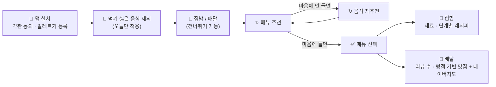

# 🍽️ 뭐먹지?

### 30초 만에 끝내는 오늘의 메뉴 결정

매끼 *"오늘 뭐 먹지?"* 를 고민하는 사람들을 위한 메뉴 추천 서비스입니다. 
알레르기와 먹기 싫은 음식을 반영해 추천하고, 집밥이면 **레시피**를, 배달이면 **근처 맛집 후보**를 이어서 보여줍니다.

---

## 🚀 어떻게 쓰나요?

| 단계 | 하는 일 |
|:---:|---|
| 1️⃣ | **처음 한 번** 약관에 동의하고 알레르기를 등록합니다. 알레르기 등록은 건너뛸 수 있고, 마이페이지에서 언제든 고칠 수 있습니다. |
| 2️⃣ | 오늘 **먹기 싫은 음식 카테고리**를 제외합니다. 오늘만 적용되고 저장되지 않습니다. |
| 3️⃣ | **집밥 / 배달**을 고릅니다. 고르지 않고 건너뛸 수도 있습니다. |
| 4️⃣ | 앱이 조건을 반영해 **메뉴를 추천**합니다. 마음에 안 들면 이전 메뉴를 빼고 다시 받거나, 처음부터 다시 시작할 수 있습니다. |
| 5️⃣ | 메뉴를 선택하면 집밥은 **레시피**로, 배달은 **맛집 후보**로 이어집니다. |

### 🍳 집밥을 골랐다면

- 재료 목록
- 단계별 텍스트 레시피
- 영상은 보조로 유튜브 링크 제공

### 🛵 배달을 골랐다면

| 위치 정보 | 동작 |
|:---:|---|
| ✅ 허용 | 근처 식당의 **리뷰 수와 평점**을 조회해, 리뷰 수가 많고 평점이 높은 순으로 AI가 후보를 구성해 추천하고 네이버지도 링크로 연결 |
| ❌ 허용 안 함 | 배달로 자주 시켜 먹는 음식 후보 중에서 제외 조건을 반영해 랜덤 추천 |

> 📍 위치 정보는 **배달을 선택했을 때만** 사용하고, 근처 범위를 정하는 데만 씁니다.

---

## ✨ 주요 기능

|  |  |  |  |
|:---:|:---:|:---:|:---:|
| 🛡️ **알레르기 설정** | 🚫 **카테고리 제외** | 🔀 **집밥 · 배달 분기** | ✨ **메뉴 추천** |
| ↻ **재추천** | 📍 **맛집 후보 + 지도** | 📖 **재료 · 레시피** | |

---

## 💡 다른 서비스와 뭐가 다른가요?

| 기존 서비스 | 🍽️ 뭐먹지? |
|---|---|
| 🎲 랜덤 추천 | 🛡️ 알레르기 한 번 저장 |
| 🛵 배달 추천 | 🚫 비선호 제외 |
| 📖 레시피 | ✨ 메뉴 추천 · ↻ 재추천 |
| 🧊 보유 재료 활용 | 🍳 집밥 &#124; 🛵 배달까지 **한 흐름** |
| 기능이 **하나씩 따로** | 재료 입력 · 사진 촬영 없이 **바로 시작** |
